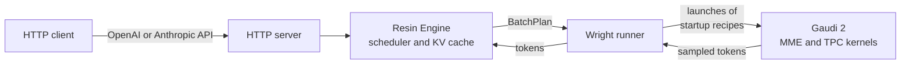

<div align="center">

# Wright

**A new inference engine for Intel Gaudi 2.**


[](https://discord.gg/SXJcQM79j4)

<table>
<tr><th colspan="4">Qwen3.8-27B, one HL-225 card</th></tr>
<tr>
<td align="center"><h3>115 tok/s</h3>decode, 1 request<br><sub>MTP-2, 1K context</sub></td>
<td align="center"><h3>567 tok/s</h3>decode, 32 requests<br><sub>no drafts, 1K context</sub></td>
<td align="center"><h3>4.9K tok/s</h3>prefill<br><sub>4K prompt</sub></td>
<td align="center"><h3>0</h3>compilations after startup<br><sub>from the server log</sub></td>
</tr>
<tr><th colspan="4">Mistral-Large-4, 8 HL-225 cards</th></tr>
<tr>
<td align="center"><h3>74 tok/s</h3>decode, 1 request<br><sub>DSpark-3, 2K context</sub></td>
<td align="center"><h3>263 tok/s</h3>decode, 16 requests<br><sub>no drafts, 2K context</sub></td>
<td align="center"><h3>2.0K tok/s</h3>prefill<br><sub>8K prompt</sub></td>
<td align="center"><h3>0</h3>compilations after startup<br><sub>from the server log</sub></td>
</tr>
<tr><th colspan="4">GLM-5.3-Flash, 8 HL-225 cards</th></tr>
<tr>
<td align="center"><h3>130 tok/s</h3>decode, 1 request<br><sub>MTP-1, 1K context</sub></td>
<td align="center"><h3>387 tok/s</h3>decode, 16 requests<br><sub>no drafts, 1K context</sub></td>
<td align="center"><h3>4.3K tok/s</h3>prefill<br><sub>4K prompt</sub></td>
<td align="center"><h3>0</h3>compilations after startup<br><sub>from the server log</sub></td>
</tr>
<tr><th colspan="4">DeepSeek-V4.1-Flash, 8 HL-225 cards</th></tr>
<tr>
<td align="center"><h3>126 tok/s</h3>decode, 1 request<br><sub>DSpark-3, 1K prompt</sub></td>
<td align="center"><h3>257 tok/s</h3>decode, 8 requests<br><sub>mostly no drafts, 1K prompt</sub></td>
<td align="center"><h3>4.0K tok/s</h3>prefill<br><sub>4K prompt</sub></td>
<td align="center"><h3>0</h3>compilations after startup<br><sub>from the server log</sub></td>
</tr>
</table>

<sub>English text with sampling, through the server. With more than one request, the decode value
includes the prefill of the other requests. Read <a href="#performance">Performance</a>.</sub>

[Introduction](#introduction) ·
[Supported models](#supported-models) ·
[What it does](#what-it-does) ·
[Performance](#performance) ·
[How to run it](#how-to-run-it)

</div>

---

## Introduction

Wright is a new inference engine for Intel Gaudi 2.

Why "Wright"? I needed a name, and it was midnight. Gaudi takes its name from Antoni Gaudí.
The only other architect that I could remember was Frank Lloyd Wright.

It just felt Wright.

## Supported models

| Model | Weights | Cards | Status | Tests |
|---|---|---|---|---|
| Qwen3.8-27B | FP8 safetensors | 1 | 🟢 Lab Ready | Throughput sweep, GPQA Diamond |
| Mistral-Large-4 | `UD-Q4_K_XL` GGUF | 8 | 🟢 Lab Ready | Throughput sweep, GPQA Diamond on 155 of 198 questions |
| GLM-5.3-Flash | FP8 safetensors | 4 or 8 | 🟢 Lab Ready | Throughput sweep, GPQA Diamond |
| DeepSeek-V4.1-Flash | FP4 and FP8 safetensors | 8 | 🟡 In Testing | Server check, throughput with 1 to 8 requests, GPQA Diamond |
| Qwen3.5-9B | FP8 safetensors from a third party | 1 | 🟡 In Testing | Server check, throughput with 1 and 8 requests |
| Qwen3.5-4B | FP8 safetensors from a third party | 1 | 🟡 In Testing | Server check, throughput with 1 and 8 requests |
| Qwen3.5-2B | FP8 safetensors from a third party | 1 | 🟡 In Testing | Server check, throughput with 1 and 8 requests |
| Qwen3.5-0.8B | FP8 safetensors from a third party | 1 | 🟡 In Testing | Server check, throughput with 1 and 8 requests |

| Status | Meaning |
|---|---|
| 🟢 **Lab Ready** | The model is ready to serve in a lab. |
| 🟡 **In Testing** | The model works. It needs more throughput sweeps, or a longer test with many requests. |
| 🔴 **Bleeding Edge** | Early support, for example a model before its release or an experimental quantization. Expect problems. No model has this status now. |

## What it does

Wright supports inference on the models in [Supported models](#supported-models).

| Item | Qwen3.8-27B | Mistral-Large-4 | GLM-5.3-Flash | DeepSeek-V4.1-Flash | Qwen3.5 0.8B to 9B |
|---|---|---|---|---|---|
| **Preset** | `qwen3_5-gaudi2` | `mistral_large4-gaudi2` | `glm5_3_flash-gaudi2`, `-tp4`, `-256k` | `deepseek_v41-gaudi2` | `qwen3_5-0.8b-gaudi2`, `-2b-`, `-4b-`, `-9b-` |
| **Weights** | FP8 safetensors | `UD-Q4_K_XL` GGUF | FP8 safetensors | FP4 and FP8 safetensors | FP8 safetensors from `surogate` |
| **Cards** | 1 | 8 | 8, or 4 with `-tp4` | 8 | 1 |
| **Default maximum batch** | 32 sequences | 16 sequences | 16 sequences | 16 sequences | 32 sequences |
| **Default context** | 32,768 tokens | 65,536 tokens | 65,536 tokens, 32,768 with `-tp4`, 262,144 with `-256k` | 131,072 tokens | 32,768 tokens |
| **Speculative decoding** | MTP with 2 draft tokens, on by default | DSpark with 3 draft tokens, off by default | MTP with up to 3 draft tokens, off by default | DSpark from the checkpoint with up to 5 draft tokens on batches of up to 2 sequences, off by default | MTP, off by default. Needs the MTP weights from the official checkpoint |
| **Chat recipe** | `qwen3_8` | `mistral_large4` | `glm5_3_flash` | `deepseek_v41` | `qwen3_5`. 0.8B and 2B start with thinking off |

Wright uses the Synapse graph compiler and custom TPC-C kernels directly. The models do not run on
PyTorch. The multi-card presets use CPU-only `torch` for one thing: the Gloo control plane between
processes. Wright uses [Resin](RESIN.md) for the scheduler, the cache allocator, and the HTTP server.



Wright has these features:

| Feature | Description |
|---|---|
| **One compile phase** | Wright compiles all graphs at startup. Context lengths, device addresses, and sampling values are not part of a graph. |
| **KV cache** | Sequences keep key and value (KV) rows in pages of one paged device arena. |
| **Prefix cache** | A new request can reuse a cached prefix at each prefix cache boundary of the model. |
| **Speculative decoding** | The Qwen models and GLM-5.3-Flash use multi-token prediction (MTP). Mistral-Large-4 can use a DSpark drafter. DeepSeek-V4.1-Flash uses the DSpark layers of its checkpoint. Greedy and seeded decoding gives the same tokens as decoding without drafts. |
| **Multiple cards** | Mistral-Large-4, GLM-5.3-Flash, and DeepSeek-V4.1-Flash run one process on each card. All processes run the same batch and sample the same tokens. |
| **Card selection** | Each process takes a free card from the `--device` list, and skips busy cards. |
| **Clean stop** | On SIGTERM, the server stops new connections, and requests in flight can finish. |
| **Overlap** | The host starts the next decode step while the card runs the current step. |
| **Sampling on the card** | Wright supports temperature, top-k, top-p, seeds, logprobs, and prompt logprobs. |
| **HTTP APIs** | The server has OpenAI Chat Completions and Responses, Anthropic Messages, `/tokenize`, `/metrics`, `/health`, and a chat page. |
| **Chat features** | The chat recipes support tool calls and reasoning effort. |

Wright has these limits:

- The vision tower is untested except on Qwen3.8-27B. Other models do not accept images or
  video.
- The Qwen models run on one card. Wright does not split these models across cards.
- The full Mistral-Large-4 model needs 8 cards. On 4 cards, its weights do not fit in card memory.
- GLM-5.3-Flash needs 4 or 8 cards.
- DeepSeek-V4.1-Flash needs 8 cards.
- A different number of cards can give different tokens for one request. A different set of cards
  with the same number gives the same tokens.
- A sampled token can have a maximum of 64 top logprobs.

> [!CAUTION]
> DO NOT USE WRIGHT IN PRODUCTION. WRIGHT IS NEW SOFTWARE, AND AN ERROR CAN STOP THE SERVER
> OR GIVE INCORRECT TOKENS.

## Performance

The throughput results come from [`scripts/sweep.py`](scripts/sweep.py). It starts the server, and
runs [llama-benchy](https://github.com/eugr/llama-benchy) against it at each context length and
number of requests. The prompts are English text from a public domain book. The sampling uses the
values of each checkpoint, with thinking off or low reasoning. The Qwen3.5 dense checkpoints have
no sampling values, so they use the values of their model cards. Each request generates 256 tokens, the prompt
fills the rest of the context, and the prefix cache is off. For the DeepSeek-V4.1-Flash results,
llama-benchy sent prompts of fixed lengths to a server that started before the run. The
DeepSeek-V4.1-Flash section gives the settings. The results use HL-225 cards, Synapse 1.24.1, and the pinned checkpoints. The dates are in UTC−7.

- **Prefill** is the prompt tokens per second of one request, up to its first token.
- **Decode** is the total of generated tokens per second for all requests together.
- **Peak** is the highest total in any one second of the run.
- **No fit** means that the sweep did not run that point, because a point with the same number
  of tokens or fewer did not fit all its requests in the KV cache at the same time.

> [!NOTE]
> llama-benchy sends all requests at the same time. Thus, with more than one request, the decode
> time includes the prefill of the other requests. At long context, most of the time is prefill.
> The sweep does not measure a server that receives requests at different times.
>
> In agentic workloads, each turn adds to a context that the server has already seen. This is
> generally not a problem there: the prefix cache holds the earlier context, so each turn prefills
> little more than the new tokens. The sweep ran before Wright divided the card time between
> prefill and decode. Its results are the same as with `--decode-share 0`. The DeepSeek-V4.1-Flash
> results use `--decode-share 25:99`. Refer to
> [Prefill stops decode for one chunk](#prefill-stops-decode-for-one-chunk).

[`docs/performance.md`](docs/performance.md) has all the results and the commands that make them.

### Qwen3.8-27B

#### Throughput

These results are from 2026-11-01, on one card.

| Context | Prefill | Decode, 1 request, no drafts | Decode, 1 request, MTP-2 | Decode, 32 requests, no drafts | Peak, 32 requests, no drafts |
|---:|---:|---:|---:|---:|---:|
| 1K | 3,460 | 64 | **115** | 567 | 758 |
| 8K | 4,757 | 63 | **103** | 122 | 272 |
| 32K | 3,659 | 53 | **71** | 26 | 79 |
| 128K | 1,831 | 33 | **45** | No fit | No fit |

- The values are tok/s. MTP-2 increases the rate of one request at every context.
- With 8 or 16 requests, drafts increase the throughput up to 4K context. With 32 requests, they
  do not. Refer to [Drafts can decrease throughput](#drafts-can-decrease-throughput).
- At 32K with 32 requests, the KV cache held 21 requests at the same time, and the others waited.

#### Server check

The last full run of `scripts/check_server.py` gave 16 passed, 0 failed, and 3 skipped checks.

- **Compile stability:** The server did 0 graph compilations after startup.
- **Evaluation:** The model got 90 of 100 questions correct on a seeded MMLU sample.
- **Prefix cache:** A repeated 4886-token prompt reused 4096 cached tokens.
- **Skipped checks:** The checks for images, the exact context limit, and the HTTP compile
  counter did not run. A later run with `/tokenize` passed the context limit check.

#### GPQA Diamond

These results are from 2026-11-02. They use `inspect_evals` 0.27.0, one pass of the 198 questions,
and temperature 0.6. The last column shows the
[Artificial Analysis](https://artificialanalysis.ai/evaluations/gpqa-diamond) score on 2026-11-01.

| Reasoning | Answer token limit | Correct | Score | Standard error | Artificial Analysis |
|---|---:|---:|---:|---:|---:|
| None | 16,384 | 161 of 198 | **81.3%** | ±2.8 | 81.8% |
| Xhigh | 64,000 | 178 of 198 | **89.9%** | ±2.1 | 90.5% |

- **Cut-off answers:** At xhigh, 5 answers reached the limit of 64,000 tokens during reasoning, so
  they gave no answer. The score counts them as incorrect. If all 5 were correct, the score would
  be 92.4%. With no reasoning, no answer reached its limit.
- **Answer length:** At xhigh, the median answer used 7,218 tokens, and the longest complete answer
  used 62,569 tokens. A separate xhigh run with a limit of 16,384 tokens scored 70.7%, because
  55 answers reached the limit. Reasoning at this level needs a large limit.
- **Comparison:** The two sources can use a different prompt, token limit, or number of passes.
  Differences smaller than the standard error do not show a difference between the models.
- **Run settings:** The run with no reasoning used no drafts and 32 requests at the same time. The
  xhigh run used MTP-2 and 8 requests at the same time. The xhigh run stopped after 120 answers,
  because one prompt and the token limit did not fit in 65,536 tokens of context. It continued
  from its saved answers with 131,072 tokens of context.

### Mistral-Large-4

#### Throughput

These results are from 2026-11-03, on 8 cards. DSpark-3 uses the drafter with 3 draft tokens.

| Context | Prefill | Decode, 1 request, no drafts | Decode, 1 request, DSpark-3 | Decode, 4 requests, no drafts | Decode, 4 requests, DSpark-3 | Decode, 16 requests, no drafts | Peak, 16 requests, no drafts |
|---:|---:|---:|---:|---:|---:|---:|---:|
| 2K | 1,981 | 48 | **74** | 129 | **141** | 263 | 273 |
| 8K | 2,043 | 43 | **60** | 96 | **104** | 176 | 192 |
| 32K | 1,439 | 35 | **48** | 72 | **79** | 24 | 88 |

- The values are tok/s. The model accepted 52% to 60% of the draft tokens.
- The drafter works on batches of up to 4 sequences, and a larger batch runs without drafts.
  Drafts are off by default. To use them, refer to [Use the DSpark drafter](#use-the-dspark-drafter).
- At 32K with 16 requests, the KV cache held 11 requests at the same time, and the others waited.
- These results replace a sweep from 2026-11-01. That sweep gave low decode rates at 8K and
  longer, for example 15 tok/s for one request at 8K. Other runs did not reproduce those values.

#### Server check

The last full run of `scripts/check_server.py` was on 2026-10-31 at the default settings. It
gave 15 passed, 1 failed, and 3 skipped checks.

- **Failed check:** The evaluation failed because one answer was missing. This request did not
  finish in the 180-second limit of the client.
- **Evaluation:** The model got 92 of 100 questions correct on a seeded MMLU sample.
- **Compile stability:** The server did 0 graph compilations after startup.
- **Long context:** A separate test put one fact into long text. The model found the fact in
  15 of 15 requests, from 1.4K to 48K tokens.
- **KV cache:** The cache holds 380,800 tokens at the default settings.
- **Skipped checks:** The checks for images, the exact context limit, and the HTTP compile
  counter did not run. No prompt above 48K tokens went through the server.

#### GPQA Diamond

A run with high reasoning stopped after 155 of the 198 questions. The model got 142 of the 155
correct (91.6%). The score of the full set is not measured yet. The run used `inspect_evals`
0.27.0, temperature 1.0, top-p 0.95, a limit of 128,000 answer tokens, no drafts, and 3 requests
at the same time. One answer reached the token limit.

### GLM-5.3-Flash

#### Throughput

These results are from 2026-11-01. The 4-card results use the `-tp4` preset, started with
131,072 tokens of context.

| Cards | Context | Prefill | Decode, 1 request, no drafts | Decode, 1 request, MTP-1 | Decode, 16 requests, no drafts | Peak, 16 requests, no drafts |
|---:|---:|---:|---:|---:|---:|---:|
| 8 | 1K | 3,268 | 100 | **130** | 387 | 483 |
| 8 | 8K | 4,228 | 90 | **124** | 103 | 249 |
| 8 | 32K | 3,517 | 96 | **121** | 25 | 174 |
| 8 | 128K | 2,092 | 85 | **118** | 4 | 156 |
| 4 | 1K | 2,396 | 91 | **108** | 270 | 335 |
| 4 | 8K | 3,266 | 87 | **112** | 78 | 169 |
| 4 | 32K | 2,615 | 85 | **108** | 18 | 128 |
| 4 | 128K | 1,424 | 77 | **100** | 3 | 52 |

- The values are tok/s. The decode rate of one request changes little with the context.
- For one request, MTP-1 gave a rate equal to or higher than MTP-2.
- On 4 cards at 128K with 16 requests, the KV cache held 11 requests at the same time.
- In a separate test on 2026-10-31, with the `-256k` preset, a 261K-token prompt took 201.6 s.

#### Server check

The last full run of `scripts/check_server.py` was on 2026-11-03. The `wright` command started the
model on 8 cards with no drafts. It gave 16 passed, 0 failed, and 3 skipped checks.

- **Evaluation:** With low reasoning, the model got 91 of 100 questions correct on a seeded MMLU
  sample.
- **Compile stability:** The server did 0 graph compilations after startup.
- **Prefix cache:** A repeated 4,841-token prompt reused 4,096 cached tokens.
- **Skipped checks:** Images, reasoning effort, and the HTTP compile counter.
- **Long context:** In a separate test on 2026-10-31, the model found a fact in long text in 15 of
  15 requests, up to 38K tokens. With the `-256k` preset, it found the fact in 10 of 10 requests at
  128K and 256K.

#### GPQA Diamond

These results are from 2026-11-02. They use `inspect_evals` 0.27.0, one pass of the 198 questions,
and the model's default reasoning, which is Max. The last column shows the
[Artificial Analysis](https://artificialanalysis.ai/evaluations/gpqa-diamond) score on 2026-11-01.

| Temperature | Top-p | Answer token limit | Correct | Score | Standard error | Artificial Analysis |
|---:|---:|---:|---:|---:|---:|---:|
| 1.0 | 0.95 | 64,000 | 174 of 198 | **87.9%** | ±2.3 | 91.2% |
| 0.6 | Not set | 64,000 | 158 of 198 | 79.8% | ±2.9 | |

- **Sampling:** Temperature 1.0 and top-p 0.95 are the values in the model's
  `generation_config.json`. Use these values. At temperature 0.6, 25 answers reached the limit, and
  22 of them ended in repeated text. At temperature 1.0, 8 answers reached the limit, and 1 of them
  ended in repeated text.
- **Cut-off answers:** The score counts the 8 answers at temperature 1.0 as incorrect. If all 8 were
  correct, the score would be 91.9%.
- **Answer length:** At temperature 1.0, the median answer used 4,350 tokens, and the longest
  complete answer used 60,814 tokens. Of the 198 answers, 37 used more than 16,384 tokens.
- **Comparison:** Artificial Analysis uses temperature 0.6 for reasoning models, unless the model
  lab recommends a different value. It does not state the value for this model. The two sources
  can also use a different prompt, token limit, or number of passes.
- **Run settings:** Both runs used 8 cards, no drafts, 16 requests at the same time, and 131,072
  tokens of context.

### DeepSeek-V4.1-Flash

#### Throughput

These results are from 2026-11-05, on 8 cards, with DSpark-3. The server used 512,000 tokens of
context, a batch of 8 (`-np 8`), and `--decode-share 25:99`. Each prompt has 1K, 4K, or 32K tokens.
Each request generates a maximum of 1,024 tokens.

| Prompt | Prefill | Decode, 1 request, DSpark-3 | Decode, 8 requests | Peak, 8 requests |
|---:|---:|---:|---:|---:|
| 1K | 3,157 | 126 | 257 | 395 |
| 4K | 4,021 | 128 | 158 | 277 |
| 32K | 3,277 | 119 | 37 | 129 |

- The values are tok/s. DSpark runs only on decode steps of 2 sequences or fewer. A larger step
  runs without drafts. Thus, with 8 requests, most steps have no drafts.
- The model accepted 45% of the draft tokens in total, and 41% to 57% in each cell. These results
  do not include a run with no drafts at the same settings.
- A request stops when the model ends its answer. Thus, some requests generate fewer than 1,024
  tokens. Wright does not support `min_tokens` or `ignore_eos`.
- With 8 requests, prefill decreases to approximately 1,500 tok/s, because decode gets up to 99% of
  the card time.
- At 32K, a prefill takes approximately 10 s, and a reply takes less time. Thus, the 8 requests
  decode mostly one after the other, not at the same time.
- [`docs/performance.md`](docs/performance.md#deepseek-v41-flash-8-cards) has the results for 2 and
  4 requests, and for replies of up to 512 tokens.

#### Server check

The last full run of `scripts/check_server.py` was on 2026-11-05, with 131,072 tokens of context and
the stress checks. It gave 13 passed, 0 failed, and 4 skipped checks.

- **Compile stability:** The server did 0 graph compilations after startup.
- **Context limit:** The check of the exact context limit of 131,072 tokens passed.
- **Prefix cache:** The check passed. In a separate test, a 29K-token prompt got its first token in
  8.25 s. The same prompt got its first token in 0.29 s the second time.
- **Skipped checks:** Images, reasoning effort, the HTTP compile counter, and the MMLU evaluation.
  The run had no MMLU question file.

#### GPQA Diamond

These results are from 2026-11-06. They use `inspect_evals` 0.27.0, one pass of the 198 questions,
and Max reasoning.

| Reasoning | Temperature | Top-p | Answer token limit | Correct | Score | Standard error |
|---|---:|---:|---:|---:|---:|---:|
| Max | 1.0 | 1.0 | 262,144 | 187 of 198 | **94.4%** | ±1.6 |

- **Sampling:** The `README.md` of the checkpoint recommends temperature 1.0, top-p 1.0, and a limit
  of 256K answer tokens or more. The run used these values.
- **Cut-off answers:** No answer reached the limit. The model completed all 198 answers.
- **Answer length:** The median answer used 7,830 tokens, and the longest answer used 93,622 tokens.
  Of the 198 answers, 60 used more than 16,384 tokens. With a limit of 64,000 tokens, as in the
  Qwen3.8-27B and GLM-5.3-Flash runs, 8 answers would reach the limit.
- **Scorer:** One answer ended with `ANSWER: $B`. The scorer found no letter in this answer, and
  counted it as incorrect. B was the correct letter. If the scorer accepted this answer, the score
  would be 94.9%.
- **Comparison:** Artificial Analysis and the `README.md` of the checkpoint give no GPQA Diamond
  score for this model.
- **Run settings:** The run used 8 cards, DSpark-3, and 2 requests at the same time. DSpark runs
  only on decode steps of 2 sequences or fewer. Thus, it ran on each decode step. The server used
  512,000 tokens of context, a batch of 8 (`-np 8`), and `--decode-share 25:99`.
- **Duration:** The run took 4 h 48 min. On average, the 2 requests generated approximately
  170 tok/s in total.

### Qwen3.5 0.8B to 9B

#### Throughput

These results are from 2026-11-03, on one card for each model, with no drafts and 8K context.

| Model | Prefill | Decode, 1 request | Decode, 8 requests | Peak, 8 requests |
|---|---:|---:|---:|---:|
| Qwen3.5-9B | 12,994 | 169 | 304 | 517 |
| Qwen3.5-4B | 15,999 | 240 | 361 | 637 |
| Qwen3.5-2B | 30,447 | 389 | 674 | 1,102 |
| Qwen3.5-0.8B | 36,359 | 504 | 818 | 1,309 |

The values are tok/s. The four models ran at the same time, on four different cards.

#### Server check

The `wright` command started each model, and `scripts/check_server.py` ran against it on 2026-11-03.
Each model gave 15 passed, 1 failed, and 3 skipped checks.

- **Passed checks:** Chat, logprobs, and concurrent requests. Prompts of up to 16K words, and the
  exact context limit of 32,768 tokens. The prefix cache. The stress checks with 1, 4, and 16
  requests, invalid input, and recovery.
- **Failed check:** The MMLU evaluation fails if an answer is missing or cut off, or if fewer than
  50 are correct. The 9B and 4B models think first. Some of their answers did not finish in the
  180-second limit of the client, and some reached the limit of 16,384 tokens. The 2B and 0.8B
  models sometimes write the answer in a form that the check does not read. The 0.8B model got
  fewer than 50 correct.
- **Skipped checks:** Images, reasoning effort, and the HTTP compile counter.

| Model | MMLU, correct of 100 | Missing answers |
|---|---:|---:|
| Qwen3.5-9B | 82 | 8 |
| Qwen3.5-4B | 75 | 13 |
| Qwen3.5-2B | 71 | 1 |
| Qwen3.5-0.8B | 45 | 6 |

For more detail, read [`models/gaudi/README.md`](models/gaudi/README.md).

## Caveats

### Prefill stops decode for one chunk

A launch does prefill or decode, not both. While a new prompt prefills, the sequences in decode stop.
If no batch position is free, decode continues and the new prompt waits.

Wright divides the card time between prefill and decode. After each prefill chunk, decode runs for
its share of the time before the next chunk starts. Thus, a stream stops for one prefill chunk at a
time, not for the full prefill.

- `--decode-share MIN:MAX` sets the share of decode. The share is MIN with no sequence in decode.
  It increases to MAX when all batch positions decode. A larger share keeps the streams fast, but
  the new prompt gets its first token later.
- `-b` sets the tokens per prefill chunk. A smaller chunk gives a shorter stop, but prefill is
  slower.

With `--decode-share 0`, Wright runs the full prefill of a new prompt before decode continues.
Request priority does not change this order. The stop is then as long as the full prefill.

The table shows the results of `scripts/gap_bench.py` on Qwen3.8-27B with one card. 15 streams decode
with MTP-2, and then one prompt arrives. With 15 of 32 batch positions in decode, `50:90` gives decode
69% of the card time. The longest gap is the longest time between two chunks of one stream while the
prompt prefills. With no prefill, the median gap is 40 to 53 ms.

| Prompt length | Setting | Longest gap | Time to first token |
|---:|---|---:|---:|
| 6.4K tokens | `--decode-share 0 -b 4096` | 1.4 s | 1.4 s |
| 6.4K tokens | `--decode-share 50:90 -b 4096` | 0.92 s | 3.3 s |
| 6.4K tokens | `--decode-share 50:90 -b 1024` | 0.37 s | 4.5 s |
| 13K tokens | `--decode-share 0 -b 4096` | 2.9 s | 3.1 s |
| 13K tokens | `--decode-share 50:90 -b 4096` | 1.1 s | 9.0 s |
| 13K tokens | `--decode-share 50:90 -b 1024` | 0.42 s | 9.3 s |
| 26K tokens | `--decode-share 0 -b 4096` | 6.6 s | 6.9 s |
| 26K tokens | `--decode-share 50:90 -b 4096` | 1.4 s | 20 s |
| 26K tokens | `--decode-share 50:90 -b 1024` | 0.62 s | 21 s |

While the prompt prefills, each stream continues at 11 to 14 tok/s with `50:90`, and below 2 tok/s
with `0`. A fixed load of 15 streams with 1500 tokens each and three 13K prompts took 37.4 s with
`50:90` and 36.4 s with `0`. Thus, the time division costs approximately 3% of the total throughput.
At `-b 1024`, the same load took 37.9 s and 36.9 s.

On Mistral-Large-4 with 8 cards, 2048-token prefill launches, and `--decode-share 0`, the longest gap
was 3.7 s, 7.3 s, and 17 s for 6.4K, 13K, and 26K tokens.

With more than one request, the decode results in [Performance](#performance) include these stops,
because llama-benchy sends all requests at the same time. The results for one request and the
`scripts/bench.py` results below do not include them.

### Drafts can decrease throughput

Speculative decoding adds work to each step. Drafts help when few sequences are active and the model
accepts many drafts. In a large batch, they can decrease the total throughput. The number of draft
tokens does not change while the server runs, so set `--spec-draft-n-max` for the number of requests that
you expect. We plan to change this number with the batch size in a later version.

The tables show tok/s from `scripts/bench.py` with sampling at 8K context, in the form English / code.
Each value is the range from two seeds. This benchmark runs the engine without the HTTP server, and
its decode time does not include prefill. Thus, its values are higher than the decode values in
[Performance](#performance).

**GLM-5.3-Flash on 8 cards.** Drafts decrease the throughput at batch size 4 and larger. GLM-5.3-Flash
starts with no drafts. If you send one request at a time, use `--spec-draft-n-max 1`.

| Batch size | No drafts | 1 draft token | 2 draft tokens | 3 draft tokens |
|---:|---:|---:|---:|---:|
| 1 | 95 / 91-97 | 122-134 / 132-141 | 103-135 / 140-143 | 97-128 / 143-158 |
| 4 | 280-281 / 280-290 | Not measured | 187-200 / 252-262 | Not measured |
| 16 | 492 / 492-493 | 314-323 / 377-379 | 220-228 / 307-309 | 180-193 / 301-303 |

**Qwen3.8-27B on 1 card.** The result changes with the text, because the model accepts more drafts on
code. Qwen3.8-27B starts with 2 draft tokens. For English at 8K context or longer with 8 or more
requests, use `--spec-draft-n-max 0`.

| Batch size | No drafts | 2 draft tokens |
|---:|---:|---:|
| 1 | 61 / 61 | 86-111 / 115-120 |
| 8 | 321 / 320 | 307-314 / 410-415 |
| 32 | 621 / 619-620 | 531-541 / 709 |

**Mistral-Large-4 on 8 cards.** The drafter works on batches of up to 4 sequences, and a larger batch
runs without drafts. Drafts are off by default. In this benchmark, 3 draft tokens did not increase the
English rate at batch size 4. Through the server, DSpark-3 increased the decode rate at 1 and 4
requests. Refer to [Mistral-Large-4](#mistral-large-4).

| Batch size | No drafts | 3 draft tokens |
|---:|---:|---:|
| 1 | 43 / 42 | 55 / 57-62 |
| 4 | 94 / 94 | 90-92 / 112-114 |

## How to run it

### Prerequisites

You must have these items. For the exact packages, and for the items that you do not need, read
[`docs/install.md`](docs/install.md).

| Item | Value |
|---|---|
| **Cards** | 1 free Gaudi 2 card for Qwen3.8-27B, 8 for Mistral-Large-4, 4 or 8 for GLM-5.3-Flash (the tests used HL-225) |
| **Gaudi driver** | `habanalabs-dkms` and `habanalabs-firmware` |
| **Synapse API** | `habanalabs-graph`: `libSynapse.so`, `synapse_api.h`, and HCCL (the tests used Synapse 1.24.1) |
| **TPC-C compiler** | `tpc-clang`, in `habanalabs-tools`, which builds the kernels (the tests used 2.7.33) |
| **Host tools** | `gcc`, `g++`, Python 3.11 or later, [`rustup`](https://rustup.rs), and [`uv`](https://docs.astral.sh/uv/) |
| **Disk** | 29 GB for Qwen3.8-27B, 306 GiB for GLM-5.3-Flash, or 564 GiB for Mistral-Large-4 |
| **Host memory** | The Mistral-Large-4 tests used 125 GB |

Wright keeps Resin in this repository, so you do not install it. You do not need the Intel Gaudi
PyTorch packages.

### Start Qwen3.8-27B

1. Get the source code:

   ```bash
   git clone https://github.com/abotsis/wright.git
   cd wright
   ```

2. Download the pinned checkpoint:

   ```bash
   uv run --no-default-groups --group gaudi hf download Qwen/Qwen3.8-27B-FP8 \
     --revision 017b9c7af6b5689d5dd426a76e0bc077eb5ca20a \
     --local-dir ~/models/Qwen3.8-27B-FP8
   ```

3. Start the server:

   ```bash
   uv run --no-default-groups --group gaudi wright -m ~/models/Qwen3.8-27B-FP8
   ```

4. Wait for the `qwen3_5-gaudi2 is ready at http://127.0.0.1:8080` line. With the kernels and
   recipes in the cache, startup takes approximately 1 minute. The first start also builds them,
   so it takes longer. The server shows the progress of the weight load.

5. Open <http://127.0.0.1:8080> for the chat page, or send a request:

   ```bash
   curl http://127.0.0.1:8080/v1/chat/completions \
     -H 'Content-Type: application/json' \
     -d '{
       "model": "Qwen/Qwen3.8-27B-FP8",
       "messages": [{"role": "user", "content": "Who was Antoni Gaudí?"}],
       "max_tokens": 256
     }'
   ```

6. Press Ctrl-C to stop the server. The server shows the number of compilations after startup.

> [!NOTE]
> The `gaudi` group installs only what the server and the benchmark need. The default group
> also installs the development and test tools.

> [!WARNING]
> DO NOT SET `--host 0.0.0.0` ON AN OPEN NETWORK. THE SERVER HAS NO AUTHENTICATION, SO ANY
> USER ON THE NETWORK CAN SEND REQUESTS TO YOUR CARD.

### Start Mistral-Large-4

1. Get the source code. Use step 1 of [Start Qwen3.8-27B](#start-qwen38-27b).

2. Download the pinned weights:

   ```bash
   uv run --no-default-groups --group gaudi hf download unsloth/Mistral-Large-4-1T-A52B-GGUF \
     --revision 1eb4373d37e76f6e7b4b8efa20e1b1ca40b3b964 \
     --include 'UD-Q4_K_XL/*.gguf' \
     --local-dir ~/models/Mistral-Large-4-1T-A52B-GGUF
   ```

3. Download the pinned tokenizer:

   ```bash
   uv run --no-default-groups --group gaudi hf download mistralai/Mistral-Large-4-1T-A52B-NVFP4 \
     --revision bb6d00fe249b0e876f0cffc6b85014be02de3e68 \
     --include 'tokenizer*.json' --include chat_template.jinja --include params.json \
     --local-dir ~/models/Mistral-Large-4-tokenizer
   ```

4. Start the server:

   ```bash
   uv run --no-default-groups --group gaudi wright -m ~/models/Mistral-Large-4-1T-A52B-GGUF \
     --tokenizer ~/models/Mistral-Large-4-tokenizer
   ```

5. Wait for the `mistral_large4-gaudi2 on 8 cards is ready at http://127.0.0.1:8080` line.
   Startup takes approximately 8 minutes, and the server shows the progress of the weight load.

6. Send a request with the model name `unsloth/Mistral-Large-4-1T-A52B-GGUF`:

   ```bash
   curl http://127.0.0.1:8080/v1/chat/completions \
     -H 'Content-Type: application/json' \
     -d '{
       "model": "unsloth/Mistral-Large-4-1T-A52B-GGUF",
       "messages": [{"role": "user", "content": "Who was Antoni Gaudí?"}],
       "max_tokens": 256
     }'
   ```

7. Press Ctrl-C to stop the server.

### Start GLM-5.3-Flash

1. Get the source code. Use step 1 of [Start Qwen3.8-27B](#start-qwen38-27b).

2. Download the pinned checkpoint:

   ```bash
   uv run --no-default-groups --group gaudi hf download zai-org/GLM-5.3-Flash \
     --revision 46a050bec13002ad29ee795c16e61cf4fa3c4a9c \
     --local-dir ~/models/GLM-5.3-Flash
   ```

3. Start the server. To use 4 cards, add `--ranks 4`. For a context of 262,144 tokens, add
   `-c 262144`:

   ```bash
   uv run --no-default-groups --group gaudi wright -m ~/models/GLM-5.3-Flash
   ```

4. Wait for the `glm5_3_flash-gaudi2 on 8 cards is ready at http://127.0.0.1:8080` line.

5. Send a request with the model name `zai-org/GLM-5.3-Flash`.

### Start DeepSeek-V4.1-Flash

1. Get the source code. Use step 1 of [Start Qwen3.8-27B](#start-qwen38-27b).

2. Download the pinned checkpoint. It is 475 GiB:

   ```bash
   uv run --no-default-groups --group gaudi hf download deepseek-ai/DeepSeek-V4.1-Flash-1017 \
     --revision 1bae0e1088993b9b82de08f59de5be5a34e42170 \
     --local-dir ~/models/DeepSeek-V4.1-Flash-1017
   ```

3. Start the server. For DSpark speculative decoding, add `--spec-draft-n-max 3`:

   ```bash
   uv run --no-default-groups --group gaudi wright -m ~/models/DeepSeek-V4.1-Flash-1017
   ```

4. Wait for the `deepseek_v41-gaudi2 on 8 cards is ready at http://127.0.0.1:8080` line.
   Startup takes approximately 13 minutes from an NVMe disk. The server shows the progress of the
   weight load.

5. Send a request with the model name `deepseek-ai/DeepSeek-V4.1-Flash-1017`.

### Start a Qwen3.5 dense model

These steps use Qwen3.5-9B. For a different size, change `9B` in the commands to `4B`, `2B`, or `0.8B`.
Wright finds the preset from the checkpoint.

1. Get the source code. Use step 1 of [Start Qwen3.8-27B](#start-qwen38-27b).

2. Download the pinned checkpoint:

   ```bash
   uv run --no-default-groups --group gaudi hf download surogate/Qwen3.5-9B-FP8 \
     --revision 0d8b9bd14f1e192f0094a3d97b7900b82b475c12 \
     --local-dir ~/models/Qwen3.5-9B-FP8
   ```

   The pinned revisions are in `deploy/models.py`:

   | Size | Revision |
   |---|---|
   | 9B | `0d8b9bd14f1e192f0094a3d97b7900b82b475c12` |
   | 4B | `f69d4910303be8136e8c7adbfa2128999029a554` |
   | 2B | `c11f46d26e90d3ec37b858163849983c45957d73` |
   | 0.8B | `1423a80c469215a6045bd4cdb9f342fcc293d0ea` |

3. Start the server:

   ```bash
   uv run --no-default-groups --group gaudi wright -m ~/models/Qwen3.5-9B-FP8
   ```

4. Wait for the `qwen3_5-9b-gaudi2 is ready at http://127.0.0.1:8080` line.

5. Send a request with the model name `surogate/Qwen3.5-9B-FP8`.

**Speculative decoding.** These checkpoints do not have the MTP weights, so drafts are off. To add the
MTP weights from the official BF16 checkpoint, run this script once. It reads only the MTP tensors:

```bash
uv run --no-default-groups --group gaudi scripts/qwen35_mtp_fp8.py \
  --source Qwen/Qwen3.5-9B --output ~/models/Qwen3.5-9B-FP8
```

Then add `--spec-draft-n-max 2` to the server command.

### Use the DSpark drafter

Speculative decoding on Mistral-Large-4 is off by default. The drafter works on batches of up to
4 sequences, and a larger batch runs without drafts.

1. Download the drafter:

   ```bash
   uv run --no-default-groups --group gaudi hf download mistralai/Mistral-Large-4-1T-A52B-NVFP4 \
     --revision bb6d00fe249b0e876f0cffc6b85014be02de3e68 \
     --include params.json --include consolidated-00032-of-00032.safetensors \
     --local-dir ~/models/Mistral-Large-4-drafter
   ```

2. Add these flags to the server command:

   ```bash
   --spec-draft-n-max 3 -md ~/models/Mistral-Large-4-drafter
   ```

### Select the cards

To see the cards, run `wright --list-devices`. Use `--device` with the names that it shows, or with the
module IDs that `hl-smi` shows. These IDs are not the numbers in `/dev/accel/accelN`.

```bash
uv run --no-default-groups --group gaudi wright -m ~/models/GLM-5.3-Flash --ranks 4 -dev HPU0,HPU1,HPU2,HPU3
```

- `--device` sets `HABANA_VISIBLE_MODULES`, the variable that vLLM-Gaudi reads. You can set this
  variable in place of the flag.
- With no list, Wright can use all operational cards.
- A list can have more cards than the server needs. Each process skips busy cards in the list, for up
  to 60 seconds.
- If there are too few free cards, the server stops before it loads weights, and it shows the number
  of cards that it needs.

> [!NOTE]
> MODULES 0 TO 3 ARE ON ONE NUMA NODE OF THE TEST HOST, AND MODULES 4 TO 7 ARE ON THE OTHER. EACH PROCESS
> BINDS TO THE NUMA NODE OF ITS CARD.

### Server flags

`wright -m PATH` finds the runner from the contents of `PATH`: `config.json` for a checkpoint, or the
metadata of a GGUF. `PATH` can be a checkpoint directory, a GGUF directory, or one `.gguf` file. If Wright
cannot run the model, it stops and says why.

The flags have the same names as the flags of `llama-server`, for the options that Wright supports.

| Flag | Default | Description |
|---|---|---|
| `-m`, `--model PATH` | Required | Sets the model |
| `-a`, `--alias NAME` | The repository name | Sets the model name in the API |
| `-c`, `--ctx-size N` | The value of the model | Sets the maximum tokens per sequence. In `llama-server`, the slots share this value. In Wright, each sequence can use all of it. |
| `-np`, `--parallel N` | The value of the model | Sets the maximum number of sequences in a batch |
| `-b`, `--batch-size N` | The value of the model | Sets the tokens per prefill chunk. A smaller chunk stops decode for a shorter time. Qwen3.8-27B accepts 512, 1024, 2048, or 4096. GLM-5.3-Flash accepts 1024, 2048, or 4096. On Mistral-Large-4, `N` is a power of two, with a minimum of 1024. A wider chunk gives less cache. DeepSeek-V4.1-Flash accepts only 2048. |
| `--spec-draft-n-max N` | `2` for Qwen3.8-27B, `0` for the other models | Sets the number of draft tokens. `0` stops speculative decoding. Mistral-Large-4 accepts only `0` and `3`. DeepSeek-V4.1-Flash accepts `0` to `5`. The others accept `0` to `3`. |
| `-md`, `--model-draft DIR` | None | Sets the drafter directory of Mistral-Large-4 |
| `-dev`, `--device LIST` | All operational cards | Sets the cards that the server can use |
| `--list-devices` | | Shows the cards and stops |
| `--numa MODE` | `auto` | Sets the NUMA binding: `auto`, `off`, or `required` |
| `--host HOST`, `--port PORT` | `127.0.0.1`, `8080` | Sets the listen address. `--host` takes an IP address. The server has no authentication. |
| `--no-cache-prompt` | Cache on | Stops the prefix cache |
| `-lv`, `--verbosity N` | `3` | Sets the log level: 0 critical, 1 error, 2 warning, 3 info, 4 debug |
| `--log-colors MODE` | `auto` | Sets colored logs: `on`, `off`, or `auto` |
| `--log-file FNAME` | None | Also writes the log to a file |

These flags have no match in `llama-server`:

| Flag | Default | Description |
|---|---|---|
| `--tokenizer DIR` | None | Sets the tokenizer directory of Mistral-Large-4 |
| `--ranks N` | The value of the model | Sets the number of cards for GLM-5.3-Flash (4 or 8). The full Mistral-Large-4 model and DeepSeek-V4.1-Flash need 8. A new number needs a cold compile. |
| `--gpu-memory-utilization F` | The value of the model | Sets the share of free card memory for the KV cache on the one-card models, above 0 and below 1. A new value recompiles recipes at startup. |
| `--no-overlap` | Overlap on | Stops overlap |
| `--decode-share MIN[:MAX]` | `50:90` | Sets the percent of card time for decode while a prompt prefills. The share is MIN with no sequence in decode, and MAX when all batch positions decode. One number sets a fixed share. `0` runs the full prefill of each prompt before decode. Refer to [Prefill stops decode for one chunk](#prefill-stops-decode-for-one-chunk). |
| `--request-queue-capacity N` | `1024` | Sets the number of requests that can wait before HTTP 429 |
| `--stream-interval N` | `1` | Sets the number of generated tokens in each streamed chunk |
| `--drain-timeout S` | `30` | Sets the time for requests in flight to finish after SIGTERM |
| `--cache-dir DIR` | `~/.cache/resin/gaudi` | Sets the directory for compiled kernels and recipes |
| `--synapse-log-dir DIR` | `HABANA_LOGS` if it is writable | Sets the directory for Synapse logs |
| `--load-threads N` | `32` | Sets the threads that prepare GGUF weights |
| `--spin-wait S` | `0.2` | Sets the time to poll for a launch before blocking. Polling keeps one core busy. |

These variables also change the server: `HABANA_VISIBLE_MODULES`, `RESIN_GAUDI_CACHE`, `HABANA_LOGS`,
`LOG_LEVEL_ALL`, `RESIN_GAUDI_LOAD_THREADS`, `RESIN_GAUDI_SPIN_WAIT`, `CC`, and `CXX`. A flag overrides its
variable, and a variable overrides the default. The server shows the values at startup.

A variable that Synapse reads for its graph compiler changes the recipes. The next start then compiles
again.

The KV cache type is fixed for each model, so Wright has no `--cache-type-k` or `--cache-type-v`.
The Qwen models keep BF16 keys and values. Mistral-Large-4 and GLM-5.3-Flash keep FP8 latent rows,
with BF16 and f32 parts. A later release will make the KV cache type configurable.

### Startup output

The server shows the model that it found and the cards that it took. It shows the size of the KV pool
before it loads weights, and the exact size after the load. After the load, it also shows these
values:

- The free slabs of the pool. A slab is the unit that the cache allocator gives to sequences.
- The number of tokens that the pool holds in one sequence. On the Qwen models, each sequence also
  keeps recurrent state in the pool, so many sequences hold fewer tokens in total.
- The number of sequences at the full context that the pool holds. If the pool holds fewer than the
  maximum batch, this message is a warning.

For example, Qwen3.8-27B on one card shows this:

```
INFO KV pool: 45.3 GiB per card, 45.3 GiB in total; 304 of 304 slabs free; holds 690,688 tokens in one sequence
WARNING KV pool: holds 18 of 32 sequences at 32,768 tokens. More sequences than this wait, or give back cache
```

A bar shows the weight loading progress on a terminal. In a log file, a line shows the progress every
30 seconds.

### Check and monitor

- `/health` tells you that the server is running. The server only listens after its weights load.
- `/metrics` gives Prometheus metrics, which include the draft accept rate. Read
  [`docs/metrics.md`](docs/metrics.md).

### Stop the server

- **SIGTERM:** The server stops new connections, and requests in flight can finish for the time from
  `--drain-timeout`. During startup, the server stops at once.
- **Ctrl-C:** The server cancels requests in flight.

To run the server as a service, use [`deploy/systemd/wright.service`](deploy/systemd/wright.service).

### Measure the performance

The results in [Performance](#performance) come from `scripts/sweep.py`.
[`docs/performance.md`](docs/performance.md) has its commands.

To measure the engine without the HTTP server, run the benchmark on a free card:

```bash
uv run --no-default-groups --group gaudi scripts/bench.py \
  --model qwen3_5-gaudi2 \
  --checkpoint ~/models/Qwen3.8-27B-FP8 \
  --prefill-context-lengths 4096,8192,16384 \
  --decode-context-lengths 8192 \
  --decode-batch-sizes 1,8,32 \
  --draft-tokens 2
```

The benchmark takes the same `--gpu` flag. For Mistral-Large-4, use 8 cards and this command:

```bash
uv run --no-default-groups --group gaudi scripts/bench.py \
  --model mistral_large4-gaudi2 \
  --checkpoint ~/models/Mistral-Large-4-1T-A52B-GGUF \
  --tokenizer-checkpoint ~/models/Mistral-Large-4-tokenizer \
  --prefill-context-lengths 4096,8192,16384 \
  --decode-context-lengths 2048,8192,32768 \
  --decode-batch-sizes 1,4,8 \
  --draft-tokens 0
```

To check a running server, use the server check. This script has its own dependencies, so it
does not use the `gaudi` group:

```bash
uv run scripts/check_server.py http://127.0.0.1:8080 --output check.json
```

## Source code

| Path | Contents |
|---|---|
| [`models/gaudi/resin_models_gaudi/qwen3_5/`](models/gaudi/resin_models_gaudi/qwen3_5/) | The Qwen3.8-27B runner, cache arena, and checkpoint preparation |
| [`models/gaudi/resin_models_gaudi/mistral_large4/`](models/gaudi/resin_models_gaudi/mistral_large4/) | The Mistral-Large-4 runner, cache arena, and weight preparation |
| [`models/gaudi/resin_models_gaudi/glm5_3_flash/`](models/gaudi/resin_models_gaudi/glm5_3_flash/) | The GLM-5.3-Flash runner, cache arena, and weight preparation |
| [`models/gaudi/resin_models_gaudi/deepseek_v41/`](models/gaudi/resin_models_gaudi/deepseek_v41/) | The DeepSeek-V4.1-Flash runner, cache arena, and weight preparation |
| [`models/gaudi/resin_models_gaudi/gguf/`](models/gaudi/resin_models_gaudi/gguf/) | The GGUF reader |
| [`models/gaudi/resin_models_gaudi/kernels/`](models/gaudi/resin_models_gaudi/kernels/) | The TPC-C kernels |
| [`models/gaudi/resin_models_gaudi/synapse/`](models/gaudi/resin_models_gaudi/synapse/) | The Synapse runtime, the graphs, and the build |
| [`scripts/`](scripts/) | The server, the benchmark, and the server check |
| [`RESIN.md`](RESIN.md) | The documentation for Resin |

## TODO

- **Draft tokens that follow the batch size.** Change the number of draft tokens with the batch size
  while the server runs. Refer to [Drafts can decrease throughput](#drafts-can-decrease-throughput).
- **Configurable KV cache type.** Today the KV cache type of each model is fixed. Refer to
  [Server flags](#server-flags).
- **More than one model on a card.** Load several models on one card, and let the scheduler divide
  the card's time between them.
- **Qwen3.8-27B on more than one card.** Split the model across cards, as Mistral-Large-4 and
  GLM-5.3-Flash do. Today it runs on one card.
- **Qwen3.8-27B in BF16.** Load the BF16 checkpoint. Today Wright runs only the FP8 checkpoint.
- **DeepSeek-V4.1-Flash on 4 cards.** Keep the Engram tables in host memory, on an NVMe disk, or
  both. Copy to the cards only the rows that each step reads. The tables are 189 GiB of the
  475 GiB checkpoint. Without them, the other weights fit on 4 cards. Today the model needs 8 cards.
- **A common weight loader.** One loader for all models that reads each supported quantization
  format. Today each model has its own loader.
- **More weight formats.** EXL3, MXFP4 for models other than DeepSeek-V4.1-Flash, and possibly
  dequantization kernels for NVIDIA's formats.
- **Faster Qwen weight load.** Convert the FP8 bytes of the Qwen checkpoints to the Gaudi 2 range on
  the card, as GLM-5.3-Flash does, and not on the CPU.
- **Less duplicate code between models.** The model packages repeat code, for example in the
  Mistral-Large-4 and GLM-5.3-Flash runners. Move the shared parts into common modules.
- **Mistral-Large-4 GPQA Diamond.** Measure the full set of 198 questions. Refer to
  [Mistral-Large-4](#mistral-large-4).

## Contributing

For questions and discussion, join the [Unofficial Gaudi Discord](https://discord.gg/SXJcQM79j4).

Pull requests are welcome, including changes that an LLM helped to write. The person who opens the
pull request must be able to defend the change. If a reviewer asks, you must be able to explain:

- How the change works.
- Why the change is necessary.
- Why you made the change this way, and which other options you considered.
- How you tested that the change is correct. Say which tests and measurements you ran, and on which
  hardware.

## Acknowledgements

Wright uses [Resin](https://github.com/ekzhang/resin) by Eric Zhang and the Resin contributors.
Resin gives Wright its scheduler, cache allocator, HTTP server, and chat recipes. Resin's
architecture made it simple to connect all of these serving pieces to Wright's Gaudi 2 model
runners.

Wright starts from Resin commit
[`2638d85`](https://github.com/ekzhang/resin/commit/2638d8509b6661913a17642ef44e3f30e35f47e9).
The Wright repository does not keep the Resin commit history, so use the Resin repository for that
history. Read [`RESIN.md`](RESIN.md) for the documentation of Resin.

## License

| Part | License |
|---|---|
| TPC-C kernels in [`models/gaudi/resin_models_gaudi/kernels/`](models/gaudi/resin_models_gaudi/kernels/), except the twelve vision kernels below | [PolyForm Noncommercial 1.0.0](models/gaudi/resin_models_gaudi/kernels/LICENSE) |
| Vision kernels `add.c`, `add3.c`, `bias.c`, `gelu_tanh.c`, `merge2x2.c`, `merge4.c`, `resid_bias.c`, `rope_vision.c`, `splice.c` | GNU Affero GPL 3.0 or later, Copyright 2026 Nat Tuck |
| Vision kernels `ln_affine.c`, `ln_pre.c`, `softmax_rows.c` | GNU Affero GPL 3.0 or later, or PolyForm Noncommercial 1.0.0, Copyright Aaron Botsis and Nat Tuck |
| All other code | [Apache License 2.0](LICENSE) |

> [!CAUTION]
> NON-VISION KERNELS ARE FOR NONCOMMERCIAL USE ONLY, AND WRIGHT CANNOT RUN WITHOUT THEM. FOR COMMERCIAL
> USE OF WRIGHT AS A WHOLE, YOU MUST GET A SEPARATE LICENSE FROM THE AUTHOR.

I'm just a dude with a gpu habit who put hundreds of hours collectively into this. If you want to
use this to make money, glad to help - I'm just asking for some good will to recoup hardware/power
cost and some of my time.

Read [`NOTICE`](NOTICE) and [`MODIFICATIONS.md`](MODIFICATIONS.md).
